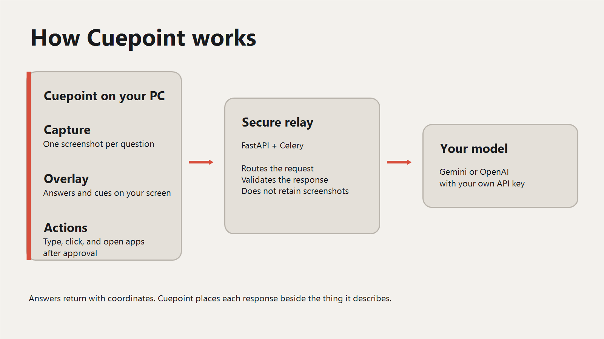

<div align="center">
  

  # Cuepoint

  ### Point. Ask. Act.

  *Screen-aware help that answers in place, guides you visually, and completes tasks under your control.*

  [](LICENSE)
  [](https://github.com/Kushal1213/cuepoint/releases/latest)
  [](https://tauri.app)
  [](backend)
  [-8b5cf6)](#bring-your-own-key)

  [Website](https://kushal1213.github.io/cuepoint/) · [Setup Guide](https://kushal1213.github.io/cuepoint/setup.html) · [Privacy](https://kushal1213.github.io/cuepoint/privacy.html) · [Releases](https://github.com/Kushal1213/cuepoint/releases) · [Issues](https://github.com/Kushal1213/cuepoint/issues)

  Developed and maintained by [Kushal Choudhary (@Kushal1213)](https://github.com/Kushal1213).
</div>

<p align="center">
  
</p>

---

## What Cuepoint does

Press `Ctrl+Alt+Space` anywhere on Windows. Cuepoint reads the current screen and keeps the answer next to the detail that matters.

- **Ask** - type a question with no prefix for a focused answer grounded in the current screen.
- **Guide** - start with `guide:` for a narrated walkthrough with points, boxes, and arrows drawn in place.
- **Act** - start with `act:` to type, open apps, search connected sources, or complete a multi-step browser task.
- **Speak** - hold `Ctrl+Win`, talk, and release. Choose on-device transcription or OpenAI under your own key.
- **Select** - press `Ctrl+Alt+Shift+Space` and draw around one region when the whole screen is too broad.
- **Review** - inspect the latest 50 Act runs in local Task History. Screenshots are never stored there.

The earlier `explain:` and `agent:` prefixes remain available as compatibility aliases.

## Bring your own key

Cuepoint does not use a shared model account. Connect a [Gemini](https://aistudio.google.com) key, an [OpenAI](https://platform.openai.com/api-keys) key, or both. The model list is loaded from your key and filtered for screenshot support. You can also enter a model ID directly.

## Install

Download the **[Cuepoint 0.3.1 Windows installer](https://github.com/Kushal1213/cuepoint/releases/download/v0.3.1/Cuepoint_0.3.1_x64-setup.exe)**. The app includes and manages its local service automatically—there is no server account, Docker, Redis, or Python setup. The **[setup guide](https://kushal1213.github.io/cuepoint/setup.html)** covers modes, voice, permissions, and optional connections.

Requires 64-bit Windows 10 (1903 or later) or Windows 11, plus the Microsoft Visual C++ Redistributable, which most PCs already have. If Cuepoint won't start and mentions a missing `MSVCP140.dll` or `VCRUNTIME140.dll`, install the [x64 redistributable](https://aka.ms/vs/17/release/vc_redist.x64.exe) and try again.

## Build from source

Cuepoint is a Tauri desktop client with a bundled FastAPI service. Both run on the same Windows computer; model requests go directly from that local service to the provider selected in Settings under the user's own key.

**Desktop client** (`app/`)
```powershell
cd app
npm install
npm run tauri dev
```

**Local service** (`backend/`)
```powershell
cd backend
python -m pip install -r requirements.txt
python local_server.py
```

Development builds target the loopback-only service at `http://127.0.0.1:43127`. Release builds package the service as a background executable and start it with Cuepoint.

**Requirements:** Rust (stable), Python 3.12, and the Tauri prerequisites for Windows. Node.js is required for the client build and is currently downloaded separately by users who opt into browser-automation tasks.

## Architecture

<p align="center">
  
</p>

The local service is a relay, not a store: screenshots, queries and answers pass through it in memory and are not sent to a Cuepoint-operated server. See [Privacy](https://kushal1213.github.io/cuepoint/privacy.html) for exactly what is kept, for how long, and why.

## Privacy and diagnostics

Diagnostics are **optional and off by default**. They use a random installation ID and never include screenshots, questions, task text, clipboard content, file content, answers, keys, or tokens. See the [privacy page](https://kushal1213.github.io/cuepoint/privacy.html) for the full data path.

## Contributing

Issues and PRs welcome. There's no formal contributing guide yet - open an issue for anything non-trivial before sending a large PR, so the approach can be agreed on first.

## License

[GNU AGPLv3](LICENSE).
